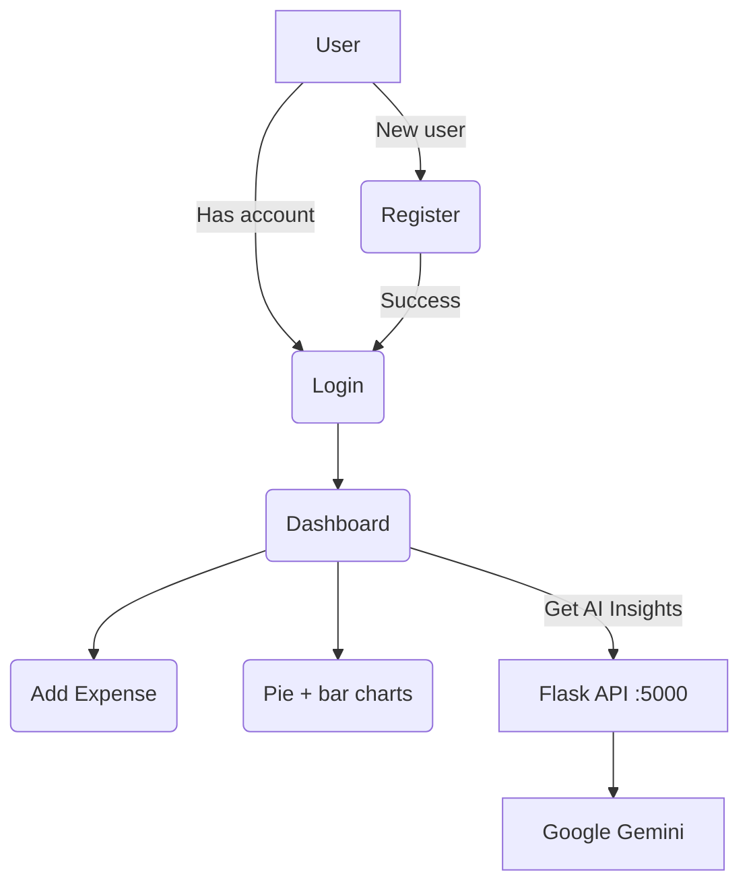

# Finance Management System

A Java Swing desktop app for tracking personal expenses, visualising spending and getting AI-generated savings tips.


## About

Finance Management System is a desktop expense tracker. Users register and log in, record expenses by category, and see their spending as pie and bar charts. A small Python Flask service sends a summary of the user's spending to Google Gemini and returns personalised financial tips, which the Java app shows on the dashboard.

## Features

- **Register and log in**: Swing login/register screens; passwords are stored as SHA-256 hashes
- **Automatic schema setup**: `users` and `expenses` tables are created on startup if they don't exist
- **Add expenses**: category, amount (INR) and date (`yyyy-MM-dd`) via a dialog
- **Expense distribution**: pie chart of total spend per category (JFreeChart)
- **Monthly spending**: bar chart of total spend per month (JFreeChart)
- **AI insights**: a "Get AI Insights" button sends the per-category totals to the Flask API, which asks Gemini (`gemini-2.0-flash`) for tips; the request runs on a background thread so the UI stays responsive

## Tech Stack

| Part | Technology |
| --- | --- |
| Desktop UI | Java Swing, JFreeChart 1.5.3 |
| Database | PostgreSQL via JDBC (`org.postgresql` 42.7.1) |
| Build | Maven |
| AI service | Python, Flask, flask-cors, google-generativeai, python-dotenv |

## How It Works



## Project Structure

```
Finance-Managmet/
├── api/
│   └── api.py                      # Flask service: POST /financial-advice
├── src/main/java/com/aryan/
│   ├── Utils/
│   │   ├── DBHelper.java           # expense queries (add, by category, by month, totals)
│   │   └── GeminiHelper.java       # HTTP client for the Flask API
│   └── myapp/
│       ├── App.java                # entry point: creates tables, opens Login
│       ├── DB/                     # Connect.java (JDBC), init.java (CREATE TABLE)
│       ├── Ui/                     # Login.java, Dashboard.java
│       └── model/                  # User, Transaction, Budget
└── pom.xml
```

## Getting Started

### Prerequisites

- JDK and Maven
- PostgreSQL running locally on port `5432`
- Python 3

### 1. Database

The JDBC connection settings (URL, user, password) are defined in `src/main/java/com/aryan/myapp/DB/Connect.java` and `src/main/java/com/aryan/Utils/DBHelper.java`. Create a matching database and user, or edit those values for your setup. Tables are created automatically on first run.

### 2. Start the AI service

```bash
cd api
python3 -m venv venv
source venv/bin/activate
pip install flask flask-cors google-generativeai python-dotenv
export GEMINI_API_KEY=your-key   # or put it in a .env file
python api.py
```

The service runs on `http://localhost:5000`, which is where `GeminiHelper` sends requests. Start it before using "Get AI Insights".

Environment variables:

| Variable | Purpose |
| --- | --- |
| `GEMINI_API_KEY` | Google Gemini API key |

### 3. Run the desktop app

Open the project in an IDE with Maven support and run `com.aryan.myapp.App`, or compile with:

```bash
mvn compile
```

## API

| Method | Endpoint | Body | Response |
| --- | --- | --- | --- |
| `POST` | `/financial-advice` | `{ "summary": "Food: 1200 INR\n..." }` | Gemini's advice as plain text; `400` if `summary` is missing |

## Author

**Aryan Bhandari**: [GitHub](https://github.com/aryanbha123)
